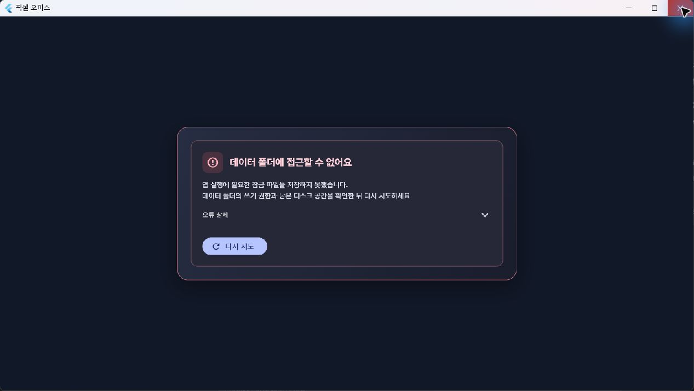

# T61 — 실패 복구와 오류 패널

- [x] 작업 시작·대화 전송의 부분 저장 실패 복원 및 요청 중복 방지
- [x] 이동·삭제된 프로젝트 경로 보호 및 부서 폴더 재지정
- [x] CLI 준비 시간 초과 오류 전환·후처리
- [x] 전체 세션·부서 팀 수 제한과 사용자 설정
- [x] 오류 안내 패널 공통화: 기동·연결·설정·작업·원격 오류
- [x] 실패 주입 회귀 검사·전체 테스트·빌드
- [x] 실제 앱 조작과 오류 패널 시각 확인

기존 인증·작업 데이터는 유지한다. 실제 서비스의 과금·한도·디스크 전체 고갈을 임의로 유발하지 않는다.

## 변경과 검증

작업 시작·대화 전달의 DB 변경을 트랜잭션으로 묶고 CLI 입력은 저장 성공 후에 큐에 넣는다.
실패 시 workflow와 생성 중인 task를 함께 되돌린다. 성공한 요청 ID는 DB 기록에서 찾아 재사용한다.
앱은 같은 작업 시작·대화의 실패 재시도에 요청 ID를 재사용하고 성공 뒤의 새 요청에는 새 ID를 발급한다.

프로젝트 경로가 사라지면 생성·새 지시·위임·재시작·복구를 막는다.
폴더 재연결은 부서의 멤버가 모두 퇴근하고 미종료 작업이 없는 경우에만 부서·팀·멤버 cwd를 함께 바꾼다.
세션 폴더를 자동으로 다른 프로젝트에 복사하지 않는다.

CLI 준비 감시는 두 엔진에 적용하고 3분 초과 시 error 상태·작업 중단·질문 정리·CLI 종료로 처리한다.
전체 세션 기본 16, 부서 팀 기본 8의 상한을 적용하고 DB에 저장하는 사용자 설정을 제공한다.
상한을 낮춰도 기존 실행은 보존하며, 거부되는 재시작이 기존 세션부터 죽이지 않도록 검사한다.

기동·연결 오류는 테두리·그림자·아이콘이 있는 카드로 표시한다.
원인 안내와 재시도 버튼을 표시하고 추가 진단은 펼쳐 볼 수 있다.
설정·환경·작업 흐름·원격 오류에도 공통 패널을 사용한다. 지시 바 오류는 눌러서 큰 패널로 볼 수 있다.
RPC 예외 코드 접두사는 사용자 안내에서 제거한다. 데몬 error 알림은 사용자가 닫을 때까지 유지한다.

- 백엔드 전체: 1,223 통과, 16 건너뜀. TypeScript 검사 통과.
- Flutter 전체: 764 통과, 1 건너뜀. Flutter analyze 통과.
- 최종 오류 문구 수정 후 관련 UI 검사 24개 및 원격/공통 패널 3개 통과.
- 마지막 세션 제한·경로 검사 보완 후 백엔드 관련 검사 12개 통과.
- Windows release 빌드 성공.

## 실제 앱 조작

테스트 전용 데이터 폴더·포트에서 잠금 경로를 막아 기동 오류 카드를 확인했다.
오류 상세 펼치기와 경로 복구 후 재시도로 사무실 기동을 확인했다.
실제 Windows 폴더 선택기로 테스트 프로젝트를 선택하고, 선택한 폴더를 일시 이동해 오류 패널을 재현했다.
폴더 복구 후 같은 화면에서 재시도하여 부서 cwd가 변경됐음을 로컬 RPC로 확인했다.
환경 점검에서 세션 제한을 4개로 저장했고 앱 종료 후 DB를 다시 열어 4개 및 바뀐 cwd의 영속을 확인했다.
원격 포트 충돌 오류 카드에서 충돌 해소 후 재시도하여 available=true와 HTTP 200을 확인했다.
격리 테스트 앱을 종료한 뒤 최종 빌드를 기존 실제 데이터로 실행했다.
sandbox 부장 idle, 대기 0건, 원격 available=true를 확인했다. CLI 인증 및 기존 원격 등록은 보존했다.

실제 서비스의 인증 만료·한도·서버 오류와 CLI 화면 버전 변경은 이번 실패 주입 검사의 대체 대상이 아니다.
일반 RPC 전체를 대상으로 한 영속 중복 방지가 아니라 작업 시작·대화 요청에 적용한 것이다.
