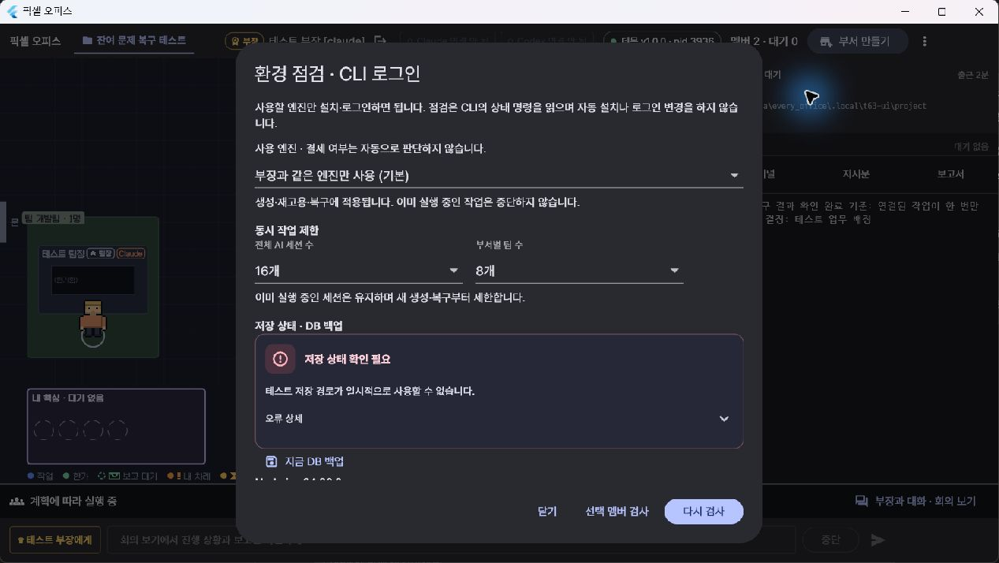

# T63 — 잔여 실패 복구

2026-10-14. [T62 점검](T62-RemainingFailureAudit.md)의 후속 구현이다.

- [x] 회의 소집·차례 전환 저장과 입력 전달의 부분 실패 복원
- [x] 업무 생성·계획 연결 및 보고·계획 상태 저장의 원자성
- [x] 기존 계획에서 미배정 업무 재시도
- [x] 이동한 프로젝트 루트의 이벤트 기록 재생성 차단
- [x] CLI 제출 확인 상태·Enter 재제출·뒤따르는 입력 보호
- [x] 주요 로컬 변경 요청의 영속 기록과 앱 재시도 식별자 보존
- [x] 모바일 재시도 식별자 보존 및 응답 유실/새로고침 검사
- [x] 로그 회전·저장 장애 회복 감지·저장 상태 패널
- [x] SQLite 무결성 검사·백업·보존 정리
- [x] 실패 주입·회귀 검사·Windows 빌드·직접 앱 조작

## 구현

회의 open/speak/resume을 저장 트랜잭션으로 처리하고 입력은 commit 뒤에 전달한다.
같은 참석자/차례의 ID는 아직 입력 대기 중일 때 큐에서 중복되지 않는다.
업무 생성과 workflow taskId를 함께 저장한다. 실패하면 blocked와 원인을 남기고 미배정 업무를 기존 계획에서 재시도한다.
보고 task와 workflow 완료 상태도 함께 저장하며 보고 이벤트와 상위 보고 전달은 commit 뒤에 실행한다.
중첩 DB 처리는 savepoint를 사용한다. 부분 저장 실패 시 이벤트나 입력이 먼저 전달되지 않는지 검사했다.

작업 status와 별도로 delivery(waiting/submitting/accepted/failed)를 기록한다.
제출 확인을 못하면 오류 카드가 표시되고 다음 자동 입력을 막는다.
재제출은 기존 입력에 Enter만 보낸다. 입력을 편집했거나 확인 창이 떠 있으면 터미널 확인을 요구한다.

주요 로컬 변경 RPC는 requestId와 입력 해시를 DB에 기록한다. 동시에 들어온 같은 요청은 한 번만 실행하며 응답 유실 뒤 결과를 다시 반환한다.
실행 결과를 저장하지 못했거나 데몬 재시작으로 결과가 불명확하면 -32009로 자동 반복을 막는다.
앱은 PC의 rpc-retries.json에 식별자를 보존한다. 원격 브라우저는 명령 본문 없이 해시/UUID/발급 시간만 IndexedDB에 저장한다.
로컬 영수증은 90일 보존한다. 오래된 미확정 앱 요청은 재전송을 막는다. 원격은 기존 Gateway의 7일 보존 범위에 맞춰 오래된 미확정 요청을 막는다.
직접 RPC 호출자는 requestId와 보존 기간을 관리해야 한다. 결과 불명확 요청은 작업 상태 확인이 필요하며 무조건 자동 복구하지 않는다.

이벤트 저장에서도 원래 프로젝트 루트를 먼저 검사한다. 같은 저장 오류는 반복 알림을 제한하고 기록 성공 시 해제한다.
로그는 5MiB와 이전 파일 3개까지 회전한다. 데몬 로그는 쓰기 실패 후 30초 간격으로 다음 로그에서 다시 시도한다.
세션 JSON과 workflow 파일은 임시 파일에서 교체해 실패한 쓰기가 이전 파일을 훼손하지 않도록 한다.
과거 완료/취소 workflow는 90일 보존하며 최신/진행 중 workflow를 보존한다. 진행 중 계획이 참조하는 보고도 보존한다.
DB 기동 시 quick_check, 일별 및 수동 SQLite 백업(VACUUM INTO), 최근 3개 보존을 제공한다.
원격 기기 DB와 CLI 세션 홈은 사무실 DB 백업 범위 밖이며 복구 안내에 명시했다.
예상하지 못한 비동기 처리 오류는 UI에 알리고 데몬 정리 경로로 보낸다.

## 검증

- 백엔드 전체: 1,232 통과, 16 건너뜀, 실패 0.
- 최종 보존/영수증/보고 검사: 26 통과. 보고 저장 실패의 task/workflow/event 동시 복원 확인.
- Flutter 전체: 766 통과, 1 건너뜀, 실패 0. 최종 미확정 요청 만료 보호 및 관련 UI/RPC 검사: 14 통과.
- TypeScript / Flutter analyze 통과. Windows release 빌드 성공.
- 실제 Chrome, 390px 화면: 등록·승인·보고·해제·지시 재제출 및 응답 유실 뒤 새로고침/재시도 통과.
  성공 응답을 버린 뒤 같은 내용을 재전송해도 upstream 논의 호출은 1회였다.
  브라우저에 작업 본문·회의·로그를 저장하지 않는 검사도 통과했다.

기존 큐 테스트는 가짜 CLI가 아무 지시도 수락하지 않아도 다음 입력이 붙는 가정을 가지고 있었다.
새 제출 확인 동작에 맞춰 큐 전용 fixture에서 수락을 명시했다. 기존 승인·질문·보고·복구 동작을 다시 검사했다.
실제 타이머를 쓰는 질문 테스트 한 곳은 빌드와 동시 실행 중 paste와 Enter 사이를 검사해 실패했다.
고정된 시간 대신 제출 상태를 제한 시간 안에서 기다리도록 수정했고 전체 검사에서 통과했다.

## 직접 앱 조작

기존 사용자 데이터와 별개인 .local/t63-ui, 포트 17520~17522에서 가짜 PTY와 테스트 DB로 실패를 재현했다.

- 부장 선택 → 제출 실패 카드 → 지시 재제출: delivery=accepted. 붙여넣기 횟수는 1회로 유지.
- 기존 blocked 계획 → 업무 배정 재시도: executing으로 바뀌고 taskId=2 연결.
  같은 버튼을 다시 눌러도 전체 작업 수 2개로 유지.
- 환경 점검 → 저장 오류 패널 확인 → 지금 DB 백업: SQLite 파일 생성.
- 오류 해소 후 다시 검사: 정상 저장 상태와 백업 경로 표시.

테스트 앱/데몬을 종료한 뒤 최신 앱을 원래 데이터로 실행했다.
기존 Claude 부장 idle, 승인 대기 0, 원격 available=true를 확인했다. 로그인/기기 등록은 유지했다.
실제 과금 작업·인증 만료·디스크 전체 고갈·전원 차단을 유발하지 않았다.
